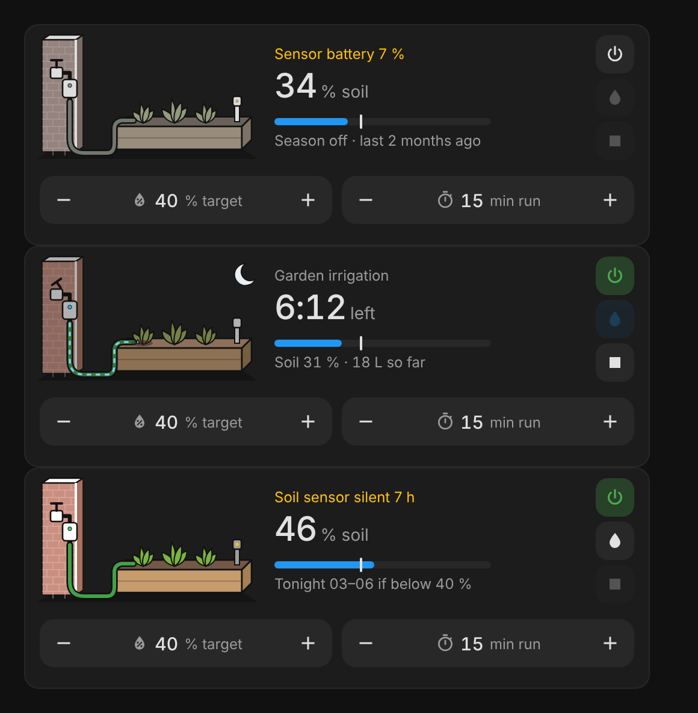

# Irrigation Card

A Home Assistant dashboard card for a garden watering valve with a soil moisture sensor. It shows soil moisture against the target, what the watering is doing, and any problems, and lets you switch the watering season on or off, water now, stop, and set the target and run time. A line drawing of the tap, valve, hose and raised bed shows it at a glance: the soil darkens as it gets wetter, and water runs through the hose while the valve is open.



Made for a SONOFF Zigbee water valve (Zigbee2MQTT) and a Xiaomi Mi Flora plant sensor, watered by an automation at night. It replaces an entities card with numberbox cards. One JavaScript file, no dependencies, no Mushroom, numberbox-card or card_mod.

## What it shows

| Part | Shows |
|---|---|
| Name row | The name, or the first warning in amber with the number of others: `Water shortage · +1` |
| Big text | Soil moisture `34 % soil`; while watering the time left `6:12 left` (from the timer), or `Watering` without a timer |
| Bar | Soil moisture, with a white mark at the target |
| Status line | `Season off · last 2 months ago`, `Tonight 03–06 if below 40 %`, `Waters tonight 03–06` (below the target), `Waters within 15 min` (below the target inside the window), `Watered 03:15 · 42 L` (for 12 hours after a run), `Soil 31 % · 18 L so far` (watering), `Valve closed` (timer running but the valve shut itself). Narrow cards get a shorter form |
| Picture | Soil colour follows the moisture; plants turn a little yellow below the target; hose, drips and the tap lever while open; valve LED green, blue (open) or red (water shortage) with a warning mark; amber dot on the valve or sensor for a low battery or a silent sensor; moon at night; faded while the season is off |

Warnings: `Water shortage` (valve status `water_shortage`, only while the season is on or while watering: the valve keeps that status until its next run, so out of season it is old news; the details pop-up still shows it), `Valve unavailable`, `Soil sensor unavailable`, `Soil sensor silent 7 h` (no update from any soil value for `stale_after` hours; BLE sensors drop out), `Valve battery 12 %` and `Sensor battery 7 %` (below `low_battery`).

## Using it

| Do | Result |
|---|---|
| Season button | Turns the watering automation on or off (`automation.turn_on` / `turn_off`). Green while on |
| Water now | Valve on (`switch.turn_on`) and the timer started for the run time (`timer.start`). Off while watering, while the valve is unavailable, and while the season is off (see below) |
| Stop | Valve off (`switch.turn_off`) and the timer cancelled if it runs (`timer.cancel`). Only on while watering, while the valve is open, or while the timer runs |
| − / + | Target (%) and run time (min) with `input_number.set_value`, in the helper's own step, min and max; the ends are disabled at the limits. The new value shows at once |
| Tap the picture or text | Details pop-up: soil (moisture, fertility, soil temperature, light, battery, last heard), valve (state, status, flow, used today, battery, closes on shortage), last run (start, end, duration, volume, last automatic start), watering (season, window, target, run time, timer). Tap a row for that entity's own dialog |
| Hold | `hold_action` (default: more-info of the valve) |

Every action goes through Home Assistant's own action handler (`perform-action`). The card never changes the automation or the helpers' settings.

Why Water now waits for the season: the watering automation also closes the valve when the timer finishes. While the automation is off, nothing would close it. If something else closes the valve after the timer (a separate automation, or the valve's own limit), set `water_now: always`.

## Install

Home Assistant 2026.11 and newer: Settings → Marketplace → Add from link → `https://github.com/BarBaar44/irrigation-card` (type Dashboard), then Install and reload the browser. The resource is served from `/local/community/irrigation-card/irrigation-card.js`.

Older Home Assistant: HACS → three dots → Custom repositories → the same link, category Dashboard.

## Configuration

```yaml
type: custom:irrigation-card
grid_options:
  columns: 12
  rows: 3
```

That is all for the owner's own garden. Everything else is optional, in YAML or the visual editor. `null` switches a part off; a misspelled option or role gives an error card.

| Option | Default | |
|---|---|---|
| `name` | `Garden irrigation` | |
| `entities` | see below | |
| `window_start`, `window_end` | `03:00`, `06:00` | the automation's watering window, for the status line (may cross midnight) |
| `low_battery` | `15` | % below which a battery warns |
| `stale_after` | `6` | hours without any soil sensor update before it warns |
| `water_now` | `season` | `season`: Water now only while the automation is on. `always`: whenever the valve is idle |
| `tap_action` | details pop-up | any HA action replaces the pop-up |
| `hold_action` | more-info | on the valve |
| `colors` | `water` blue, `on` green, `warn` amber | any CSS colour |

| Role | Default | |
|---|---|---|
| `valve` | `switch.watervalve_balcony` | required; on = water flowing |
| `valve_open` | `binary_sensor.watervalve_balcony_valve_work_state` | valve really open; without it the switch decides |
| `valve_status` | `sensor.watervalve_balcony_current_device_status` | `water_shortage` warns |
| `auto_close` | `switch.watervalve_balcony_auto_close_when_water_shortage` | details only |
| `flow` | `sensor.watervalve_balcony_flow` | details |
| `run_duration` | `sensor.watervalve_balcony_real_time_irrigation_duration` | seconds, details |
| `run_volume` | `sensor.watervalve_balcony_real_time_irrigation_volume` | litres so far / last run |
| `daily_volume` | `sensor.watervalve_balcony_daily_irrigation_volume` | details |
| `run_start`, `run_end` | `sensor.watervalve_balcony_irrigation_start_time`, `_end_time` | Unix seconds (ms and ISO also work) |
| `valve_battery` | `sensor.watervalve_balcony_battery` | |
| `moisture` | `sensor.soil_sensor_vegtable_garden_1_moisture` | % |
| `conductivity`, `soil_temperature`, `illuminance` | `sensor.soil_sensor_vegtable_garden_1_…` | details; also count as "heard from" |
| `soil_battery` | `sensor.soil_sensor_vegtable_garden_1_battery` | |
| `target` | `input_number.soil_balcony_value` | moisture target, % |
| `run_time` | `input_number.watervalve_balcony_timer_value` | minutes |
| `timer` | `timer.watervalve_balcony` | countdown, started by Water now |
| `last_started` | `input_datetime.balconyvalvelaststarted` | last automatic start |
| `automation` | `automation.balcony_valve` | the season |
| `sun` | `sun.sun` | moon at night |

The `vegtable` in the soil sensor IDs is how the real entities are spelled. A full example is in [`irrigation-card.yaml`](irrigation-card.yaml).

## Design decisions

| Decision | Why |
|---|---|
| 12 × 3 instead of 12 × 2 | the steppers need room; at 360 px a 2-row card left 54 px for the text |
| Top row laid out like Gardenview House | the two cards sit on top of each other; at 520 px the pictures are the same width, so the text lines up |
| Line art in the Tesla and Gardenview style | white surfaces, black outlines, softened red brick: one family of drawings on the dashboard |
| Warnings in the name row, status in the line | the soil sensor battery can be low for weeks; it must not hide what the watering is doing |
| Water now only while the season is on | the automation closes the valve when the timer ends; with it off the valve would stay open |
| Last run from the valve's own start and end time | it also counts runs started by Water now or by hand; the input_datetime only has the automatic ones |
| Stale from `last_reported` and every soil value | moisture can stay the same for hours; any update from the sensor means it is alive |
| Own details pop-up | more-info shows one entity; the details need fifteen |
| Water shortage hidden out of season | the valve reports `water_shortage` until its next run; over the winter that would be a warning for months about nothing |

## Development

`npm install`, then `npm test` (jsdom). Check layout changes in a real browser at 360 and 520 px section width; the card must stay 184 px high (12 × 3).

MIT licence.
